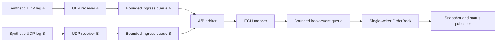

# `:app`

**Status: in-memory integration tests only.** The tests connect the arbiter
and ITCH mapper to both order books using synthetic datagrams. Run them with
`./gradlew :app:test` from the repository root. There is no application entry
point or runnable loopback demo yet.

## Planned loopback flow

The planned demo will exercise the portable UDP-to-snapshot path with synthetic
datagrams. The app will compose the arbiter and ITCH mapper from
[`nasdaq-feed`](../nasdaq-feed/README.md), the event contract from
[`feed-core`](../feed-core/README.md), and either
[`order-book`](../order-book/README.md) implementation. The arbiter and mapper
will share a thread; the book will own its state on a separate thread.

See [ADR-002](../docs/adr/ADR-002-portable-udp-feed.md) for the proposed topology
and backpressure policy.
