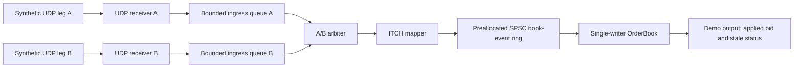

# `:app`

Run `./gradlew :app:run` from the repository root. The demo binds two
ephemeral UDP ports on loopback and sends synthetic MoldUDP64 datagrams.
The first run shows A/B gap repair and applies sequences `1000`, `1001`,
and `1002` in order. The second applies only `1000` and reports
`STALE GAP_TIMEOUT` at `1001`. No exchange connection or capture file
is needed.

## Loopback flow

Each `DatagramChannel` has its own receiver thread. The arbiter borrows
buffers from the two bounded ingress queues and returns them after
processing. If a leg runs out of buffers, the receiver counts a drop on
that leg; the other leg can still fill the gap. A full book-event ring
instead makes the run stale immediately.

The demo uses the packed book. `./gradlew :app:test` also exercises both
book layouts in memory and checks ingress buffer lifetimes and drops on
loopback.

See [ADR-002](../docs/adr/ADR-002-portable-udp-feed.md) for the topology
and overload policy.
