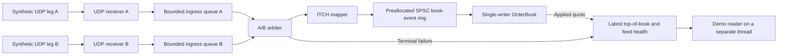

# `:app`

Run `./gradlew :app:run` from the repository root. The demo binds two
ephemeral UDP ports on loopback and sends synthetic MoldUDP64 datagrams.
The first run shows A/B gap repair, sampling the initial snapshot at
sequence `1000` and the latest live snapshot at `1002`. The second keeps
the quote from `1000` and reports `STALE GAP_TIMEOUT` at `1001`. No exchange
connection or capture file is needed.

## Loopback flow

Each `DatagramChannel` has its own receiver thread. The arbiter borrows
buffers from the two bounded ingress queues and returns them after
processing. If a leg runs out of buffers, the receiver counts a drop on
that leg; the other leg can still fill the gap. A full book-event ring
instead makes the run stale immediately.

`TopOfBookPublisher.latest()` returns one immutable view with bid, ask,
last applied sequence, and health. A strategy on another thread can read
without holding up the writer. It can miss intermediate snapshots and
must read again to see changes. Once a run is stale, its quote is retained
for diagnostics only.

The book writer reuses one scratch quote buffer. It never publishes that
mutable buffer. If only the last applied sequence advances, the new
immutable snapshot shares the unchanged quote.

The demo uses the packed book. `./gradlew :app:test` also exercises both
book layouts in memory and checks ingress buffer lifetimes and drops on
loopback.

See [ADR-002](../docs/adr/ADR-002-portable-udp-feed.md) for the topology
and overload policy.
