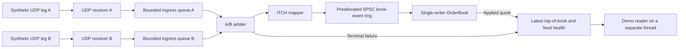

# `:app`

Run `./gradlew :app:run` from the repository root. The demo binds two
ephemeral UDP ports on loopback and sends synthetic MoldUDP64 datagrams.
The first run shows A/B gap repair, sampling the initial snapshot at
sequence `1000` and the latest live snapshot at `1002`. The second keeps
the quote from `1000` and reports `STALE GAP_TIMEOUT` at `1001`. No exchange
connection or capture file is needed.

## Loopback flow

Each `DatagramChannel` has its own receiver thread. The arbiter borrows
buffers from the two bounded ingress queues and returns them after
processing. If a leg runs out of buffers, the receiver counts a drop on
that leg; the other leg can still fill the gap. A full book-event ring
instead makes the run stale immediately.

`TopOfBookPublisher.latest()` returns one immutable view with bid, ask,
last applied sequence, and health. A strategy on another thread can read
without holding up the writer. It can miss intermediate snapshots and
must read again to see changes. Once a run is stale, its quote is retained
for diagnostics only.

The book writer reuses one scratch quote buffer. It never publishes that
mutable buffer. If only the last applied sequence advances, the new
immutable snapshot shares the unchanged quote.

The demo uses the packed book. `./gradlew :app:test` also exercises both
book layouts in memory and checks ingress buffer lifetimes and drops on
loopback.

## Paced reference baseline

Run `./gradlew :app:loopbackBaseline` for the `HashMap`/`TreeMap` book at
1,024 updates/s, with two seconds of warmup and five seconds measured per
workload. To override those three settings, use
`./gradlew :app:loopbackBaseline --args='512 2 5'`. Each synthetic add,
partial execution, or delete is sent on both UDP legs. The steady run
spaces updates evenly; the bursty run sends batches of 16 at the same
mean offered rate. This trace only has one live order at a time.

Use `./gradlew :app:loopbackBaseline --args='1024 2 5 both'` to run the same
workloads with both books. Use `packed` instead of `both` to run only the
packed book. Ingress, handoffs, pacing, and the 1 ms idle parks are unchanged.

The sampler timestamps successful snapshot publications on the book
writer. It reports p50/p99/p99.9 from both the first UDP send attempt and
the scheduled send deadline. The latter includes sender scheduling
delay. Applied rate includes any drain beyond the scheduled measurement
window. Ingress drops are application-buffer drops counted through
shutdown, including warmup; these are not kernel-drop counts. Stale and
incomplete runs are labeled, and their percentiles cover only the updates
actually published. Raw measured-event CSVs are written to
`app/build/reports/loopback-baseline/run-*/`; blank publication fields
identify unapplied updates. No strategy read or physical NIC is timed.

See the [first baseline report](../docs/benchmarks/udp-to-publication/2026-11-23-ff7288d-run-10173231853690154143.md)
and [paired book comparison](../docs/benchmarks/udp-to-publication/2026-11-23-ff7288d-run-9916005414074826539.md)
for the run configurations and measured distributions.

See [ADR-002](../docs/adr/ADR-002-portable-udp-feed.md) for the topology
and overload policy, and [ADR-003](../docs/adr/ADR-003-performance-baselines.md)
for the measurement design.
