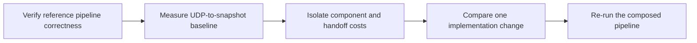

# `:benchmarks`

**Status: JMH scaffold only.** No benchmark workloads or results are checked
in yet. This module depends on production components for measurement; production
modules do not depend on it.

## Proposed measurement sequence

Compare `HashMap`/`TreeMap` with the packed book under the same event trace and
hold the surrounding pipeline constant. Measure allocation as well as latency,
and include both quantity-only updates and events that create or remove
levels. An isolated improvement is useful only if its effect on the composed
pipeline is understood.

Once workloads exist, run them with `./gradlew :benchmarks:jmh` from the
repository root. See [ADR-003](../docs/adr/ADR-003-performance-baselines.md)
for the proposed methodology.
