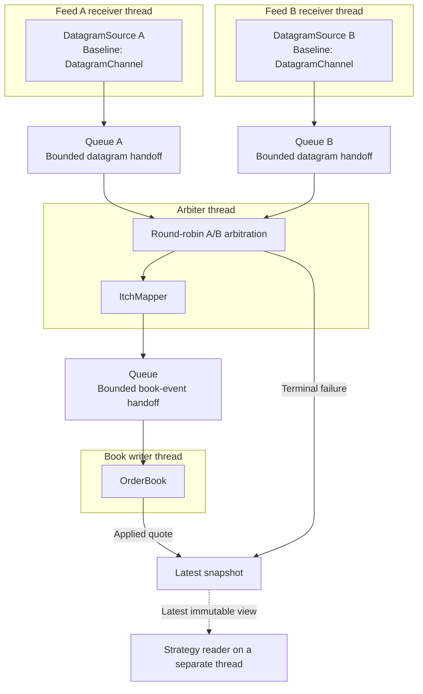

# ADR-002: Use portable UDP ingress and merge A/B before the book

**Status: Accepted through dual-leg loopback UDP ingress, the book handoff, and snapshot publication.**
Production ingress configuration remains Proposed.

**Depends on:** [ADR-001](ADR-001-reference-order-book.md)

## Context

The first network milestone should run on macOS and Linux and demonstrate
that duplicate or missing input cannot silently produce a misleading book.

## Proposed live pipeline

Use Java `DatagramChannel` with one platform thread and one bounded ingress
queue per leg. A single arbiter polls A and B round-robin in bounded batches,
skips empty queues, and maps the admitted messages. A separate bounded queue
carries those events to the single book thread. Each queue has one producer
and one consumer; the two ingress queues together provide MPSC fan-in. Use
bounded `LinkedBlockingQueue` with `offer` and `poll` as the reference;
queue implementations can change without changing the thread topology.

Start a run with one configured logical channel, MoldUDP64 session, and
expected **message** sequence, from a known-empty book. Do not join an
arbitrary mid-session capture as if that book were current. Validate framing
and session before admitting messages; discard and count invalid datagrams.
Admit the first valid copy observed for the next expected sequence, ignore
duplicates, and drain buffered messages in sequence as gaps close.

### Accepted first slice: in-memory arbitration

One owner supplies the arbiter with datagram bytes, the leg, and a monotonic
time. One arbiter instance handles one logical channel and one configured
session. It emits sequence-tagged raw messages, not decoded events. Validate
the entire datagram before admitting any of its messages. Messages held for
reordering own their payload bytes so callers can reuse datagram storage.

Bound the reorder buffer by the number of distinct pending messages.
Duplicates do not use additional capacity. Start the gap timer on the first
evidence of missing data and keep it running until the stream catches up to
the highest advertised next sequence. Timeout checks also run when no
datagrams arrive. Stale status is terminal and reports the missing sequence
and the last sequence emitted, if any. The arbiter does not know what the
downstream book has applied.

### Accepted refinement: allocate packet descriptors through an interface

Have the arbiter acquire a writable MoldUDP64 packet descriptor through a
typed `tryAcquire` / `release` interface. Choose a heap allocator or a
bounded pool at construction. The parser fills the supplied descriptor
instead of creating a packet, session array, and array of message views
per datagram. The descriptor borrows the caller's bytes; validate all
blocks before admitting any, then traverse the validated payload by offset.

Release the descriptor before `acceptAndForward` returns, including on rejection.
Report pool exhaustion without falling back to heap allocation or advancing
the sequence. Pending and emitted messages retain separately owned bytes,
so they cannot pin a descriptor or observe later writes to a recycled
datagram. Pooling ingress byte buffers or admitted messages is separate
work; this does not make the arbiter allocation-free.

Direct construction keeps the parser simpler but fixes the allocation
policy. A single private scratch descriptor would reuse storage with less
code, but it would not let callers switch between heap and pooled modes
under the same contract.

### Accepted refinement: borrow in-order payloads and pool reordered payloads

Emit raw messages to a synchronous sink using the sequence, leg, source
buffer, offset, and length. The sink borrows the bytes only for the
duration of the call and must not modify them or retain them. In-order
messages use the input datagram directly, without copying a payload or
creating a per-message buffer view. Require a sink in `acceptAndForward`; callers
that need independently owned messages opt in via `acceptAndCopy`.
Delivery is not reentrant. If the sink throws, mark the stream stale and
propagate the failure; retry could deliver an event the sink already acted on.

Copy only out-of-order messages into owned storage. Keep a heap-backed
reference option and a preallocated option behind the same contract. In
pooled mode, reuse payload slots and their sequence index; don't allocate
boxed keys or map entries per buffered message. Release a slot after
delivery or when the run becomes stale. Exhaustion uses the existing
terminal stale policy; pooled slots can hold any valid MoldUDP64 message.

Retaining whole datagrams instead would avoid the reorder copy, but
would require ownership and release to span the upstream receiver and
the arbiter. One delayed message could hold an entire datagram slot.
Copying only reordered payloads keeps the caller free to reuse its input
buffer as soon as `acceptAndForward` returns, at the cost of a bounded copy and
preallocated storage for those messages.

### Accepted slice: decode ITCH into caller-owned events

Decode one borrowed `ByteBuffer` range synchronously inside
`acceptAndForward`. Use absolute, big-endian reads without changing the
buffer's position or retaining it. For the configured stock locate, map
`A`, `E`, and `D` to the corresponding `MarketMessage` views documented in
[ADR-001](ADR-001-reference-order-book.md#wire-reference). Keep the MoldUDP64
sequence outside the decoded event.

The mapper passes validated primitive values to a caller-provided target
with separate add, execute, and delete methods. The target chooses whether
to create a heap event or fill and consume a reusable typed slot. Returning
a fresh `MarketMessage` from the mapper would be simpler for heap callers
but would put allocation policy inside the decoder. A reusable target must
not overwrite a slot while a consumer still owns it.

Validate the payload range and known type's wire length before routing.
For orders mapped into the book, validate the decoded side and share count.
The mapper does not validate unused fields or maintain a stock directory.
Do not emit book events for recognized non-book messages or for known
order messages for other stock locates. Malformed payloads, unknown types,
and unsupported mutations (`F`, `C`, `X`, `U`) for the tracked stock
locate fail explicitly. Propagate that failure out of the arbiter's sink
so the stream becomes stale instead of silently advancing past a possibly
missed mutation.

Verify the mapper with synthetic wire fixtures and an in-memory trace from
both feed legs through the arbiter and mapper into both books, including
duplicate suppression and a failure that prevents later events from being
applied. Live UDP, threaded handoffs, and snapshot publication remain out
of scope for this slice.

### Accepted slice: bounded in-memory mapper-to-book handoff

Give arbitration and decoding to one producer, and book updates to one
consumer. Keep the synchronous targets as a baseline. For the threaded
path, write each decoded update directly into a preallocated SPSC ring
slot, with the MoldUDP64 sequence stored beside the event. Skipped
messages advance the arbiter without claiming a slot. Publish only after
the slot is filled, and release only after the book callback returns.
Both cursor transfers establish visibility across the threads.

On a full ring, stop the run at the first event that could not be published.
Expose stale status outside the ring; an already borrowed event remains
valid until the callback exits, but do not drain queued work on a stale
run. A caller must not treat a book from that run as current. A fresh run
requires fresh state. Do not retry or fall back to heap allocation.

An immutable event in a bounded queue would also transfer ownership safely
and is a useful reference for future comparisons, but it does not exercise
slot reuse. Copying a synchronous borrowed event into an owned queue slot
would be safe too, at the cost of staging the same fields twice. This slice
uses synthetic datagrams and caller-owned threads; sockets, thread loops,
and snapshot publication remain out of scope.

### Accepted slice: dual-leg UDP ingress on loopback

Bind a blocking `DatagramChannel` per leg to an ephemeral loopback port.
Each receiver has one working buffer and a bounded pool of datagram buffers.
After receive, transfer ownership only if a replacement buffer is available.
Otherwise count the drop on that leg and keep the working buffer. This also
covers capacity occupied by a buffer currently borrowed by the arbiter.
Return a borrowed buffer only after synchronous admission finishes, including
if it throws. Size buffers for a full UDP datagram to avoid silent truncation.

Use bounded `ArrayBlockingQueue`s for the ready and free buffers in this
reference adapter. They do not allocate a queue node on every transfer, but
they use locks. Neither this demo nor the JDK receive call is a zero-allocation
claim. One arbiter thread polls at most one datagram per leg per pass and
checks the gap timeout even when both sockets are quiet. A separate book
thread owns the book. Closing the channels wakes blocking receivers.

The loopback demo uses synthetic datagrams to show A/B gap repair and the
terminal timeout when a gap cannot be repaired. Keep multicast, exchange
connectivity, production configuration, and a public snapshot publisher
out of scope.

### Accepted slice: publish a strategy-facing top-of-book snapshot

A strategy needs the quote and its validity in one read. It must not read
the mutable book, retain a borrowed ITCH event, or infer book progress from
the arbiter's last emitted sequence.

Strategy code runs on its own threads, intended to execute on CPU cores
separate from the feed-handler threads. The book writer publishes a value;
it never invokes strategy code inline or waits for a strategy to read it.
Correctness must not depend on where the OS schedules the threads. CPU
affinity and core isolation are deployment concerns, not part of this slice.

Expose an immutable, latest-value snapshot for one run and instrument.
Include the best bid and ask, the last applied message sequence reflected
in the snapshot, and a status:

| Status | Meaning |
|---|---|
| `NOT_READY` | No book update has been published for this run. There is no last applied sequence. |
| `LIVE` | The snapshot reflects a successfully applied book update and no terminal failure has been published. |
| `STALE` | A terminal failure has been published. Keep the last published quote and applied sequence for diagnostics, with the failure reason and its sequence. The quote is not current. |

The book thread publishes after a successful `OrderBook.apply`, even when
the best quote did not change, so the sequence reflects applied progress.
Recognized messages skipped by the mapper do not advance that sequence.
The field is absent until the first publication; zero is a valid sequence.

Start with one `AtomicReference` to the immutable snapshot. Its memory
ordering safely publishes the initialized value to readers on other cores.
Readers take one reference read and may retain the captured value, but must
read again to observe later health changes. Publish terminal handoff
failures outside the book-event ring so a full ring or a stalled book
callback cannot hide staleness. Compare-and-set both kinds of updates:
once `STALE` is published, an in-flight book update cannot replace it with
`LIVE`. If staleness wins
the race, its snapshot describes the last update actually published, not
an update that was merely queued or completed internally afterward. A new
run requires a new publisher and book.

A latest-value reference lets slow strategy readers skip intermediate
quotes without blocking the writer. A FIFO would preserve each transition,
but it adds a capacity and overload policy this use case does not need.
The book writer reuses one caller-owned top-of-book buffer. The packed book
fills it directly from its arrays. The buffer never crosses threads: the
publisher reuses unchanged immutable quote values and creates a new
immutable snapshot to publish progress. An allocation-free strategy read
contract and a lossless strategy event stream are separate work.

Verify that an independent reader thread sees a coherent quote, sequence,
and status while the book writer makes progress without waiting for it.
Also verify that an unchanged quote can advance the applied sequence, a
gap timeout or book-ring overflow publishes stale even without a new quote,
and a paused book callback cannot publish live after stale. Exercise the
publisher from the loopback demo without adding strategy logic, recovery,
or exchange connectivity.

## Portability boundary

The boxes show thread ownership; each queue sits between the producer and
consumer threads it connects. Arbitration and mapping share a thread, so
there is no queue between them. The `DatagramChannel` baseline uses the
same JDK 26 code on macOS and Linux without application-level native
bindings, kernel bypass, or CPU pinning. Latency remains host-specific.

### Interface contracts

Choose implementations at startup. The names below describe proposed
interfaces, not final Java signatures. The Nasdaq pipeline owns MoldUDP64
sequencing, threading, and failure policy; implementations within that
pipeline must preserve those contracts.

| Interface | Contract and implementation choices |
|---|---|
| `DatagramSource` | Supplies MoldUDP64 payload bytes with A/B leg identity. A `DatagramChannel` adapter or an in-memory replay source can feed the same arbiter without changing its logic. |
| `Queue` | Transfers datagrams or mapped book events in FIFO order across a thread boundary. The handoff reports when full and defines when storage can be reused. A bounded `LinkedBlockingQueue` adapter and a preallocated SPSC ring can implement the same contract without exposing `java.util.Queue` to callers. |
| `ItchMapper` | Decodes admitted ITCH bytes into caller-provided event storage without changing the admission order or depending on how the bytes arrived or how the event storage was allocated. |
| `OrderBook` | Applies decoded events on the book thread and provides top-of-book state. The `HashMap` + `TreeMap` reference and later array-based books must obey the same observable contract. |
| `TopOfBookPublisher` | Publishes the latest applied quote and feed status as one immutable view. Strategy readers need neither access to the mutable book nor a queue. |

### Allocation and ownership

Choose how short-lived datagram and book-event records are allocated at
startup, independently of the protocol logic. Each handoff exposes the same
lifecycle: claim writable storage, fill it, publish it, consume it, then
release it. Where storage is managed separately from the queue, a typed
allocator interface exposes `tryAcquire()` and `release(record)`.

| Allocation model | Implementation |
|---|---|
| On-demand JVM allocation | `NewAllocator` creates a fresh heap record with `new` on acquisition. Release ends the caller's ownership; the JVM reclaims the record once it is unreachable. The reference handoff uses fresh records and bounded `LinkedBlockingQueue` adapters. |
| Preallocated slots | `SlotAllocator` lends a reusable record from a bounded pool provisioned at startup. An SPSC ring can instead own the slots and expose the same lifecycle directly. The receiver or mapper writes into the claimed slot without an intermediate record. If no slot is available, report exhaustion; do not fall back to `new`. |

The producer must stop writing once it publishes a record, and the
consumer must stop using it after release. If arbitration holds bytes for
reordering, retain the backing storage until those bytes are no longer
needed or copy them into separately owned storage before release. These
rules apply even when release does not recycle the record. Queue capacity
and overflow policy still apply with either model.

Preallocated slots may live on the JVM heap; reuse does not imply off-heap
memory, zero-copy networking, or an allocation-free pipeline. Compare the
allocation and queue variants separately as described in
[ADR-003](ADR-003-performance-baselines.md).

### Reuse across feed protocols

The reuse boundary is the handoff of decoded book events, not
`DatagramSource`. A venue's FIX market-data feed would use its own transport,
framing, session sequencing, recovery, and mapping rules rather than the
MoldUDP64 arbiter and ITCH mapper. It can reuse the queue contract and
snapshot publisher, and it can reuse the order book if its updates map to
the same order-level contract. A price-level-only feed would need a
different book implementation; it cannot supply individual order events.
FIX support is not part of this milestone.

## Nasdaq MoldUDP64 framing

The official [Nasdaq MoldUDP64 Protocol Specification][mold] defines the
downstream framing (pp. 3–4). `DatagramChannel` delivers a UDP payload
starting with a 20-byte MoldUDP64 header: a 10-byte session identifier at
offset 0, an 8-byte big-endian first message sequence at offset 10, and a
2-byte big-endian message count at offset 18.

For a data packet, the header is followed by that many message blocks.
Each block has a 2-byte big-endian length followed by exactly that many
ITCH bytes; the length does not include the prefix itself. For example,
a packet with first sequence `1000` and count `3` carrying `A`, `E`, and
`D` has block lengths `36`, `31`, and `19`, and those messages have
sequences `1000`, `1001`, and `1002`. The arbiter merges by **message**
sequence. Only the ITCH mapper interprets those type bytes as book actions.

Count `0` is a heartbeat and `0xFFFF` is an end-of-session notice, not
65,535 message blocks. Both carry the sender's next expected sequence
without consuming a message sequence or mutating the book. A control
sequence ahead of the receiver's expected sequence can reveal a gap even
when no later data packet arrives.

## Proposed failure policy

| Condition | Behavior |
|---|---|
| A later sequence arrives before the expected one | Hold it within a configured bounded reorder capacity and a finite gap timeout. Keep polling both legs. Do not apply past the gap. |
| The gap times out or the reorder capacity is exceeded | Publish a stale status with the missing sequence and last applied sequence, even if the quote did not change. Require a fresh run from known-good input; no automatic recovery in this milestone. |
| An ingress queue is full | Count the drop on that leg. The other leg can still supply the missing messages; apply the merged-stream gap policy if a hole is observed. |
| The mapper-to-book queue is full | Mark the book stale and stop processing that run. Deliver the stale status independently of space in the saturated queue. |
| A supported book event is invalid, or the handler encounters an unsupported book mutation | Mark the book stale and stop rather than skipping a mutation. Recognized non-book messages still consume transport sequence numbers without changing the book. |

Measure the timeout from the first evidence of a hole. Make time controllable
in arbitration tests so gap behavior can be checked without sleeps. Once
declared stale, a run must not publish the book as current again.

## Alternatives and tradeoffs

A single polling thread could remove the ingress queues, while fixed
primary-leg priority would make arbitration simpler. The proposed topology
keeps reception independent and does not assume either leg is consistently
faster, at the cost of more handoffs. Bounded reordering can recover from
skew between legs but uses memory and delays the stale decision. Venue
retransmission, snapshot recovery, session rollover, audit, AF_XDP, and DPDK
are deferred.

## Acceptance criteria

For the in-memory slice, use synthetic datagrams to test duplicate and
overlapping messages, gap repair by either leg, timeout and buffer
exhaustion, control packets, and malformed framing. Feed the admitted
payloads through the mapper into each book and verify that an unsupported
mutation or malformed ITCH payload stops the run before the next event.

For the proposed live pipeline, also test queue overflow. Provide a
documented loopback demo that sends synthetic
MoldUDP64 datagrams to both sockets and publishes the expected snapshots.
No PCAP or native dependency is required to run it.

Sources: [Workflow draft](../draft/market-data-workflow.md#portable-udp-thread-topology)
and [replay inputs](../draft/ingress-comparison.md#replay-and-correctness-inputs).

[mold]: https://www.nasdaqtrader.com/content/technicalsupport/specifications/dataproducts/moldudp64.pdf
