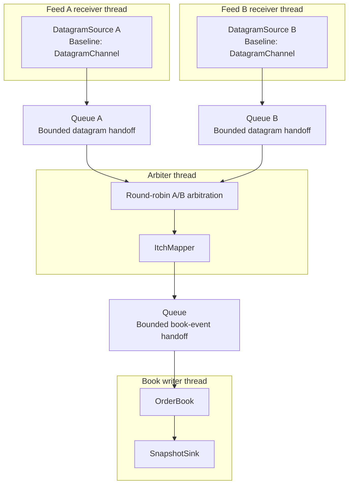

# ADR-002: Use portable UDP ingress and merge A/B before the book

**Status: Proposed**

**Depends on:** [ADR-001](ADR-001-reference-order-book.md)

## Context

The first network milestone should run on macOS and Linux and demonstrate
that duplicate or missing input cannot silently produce a misleading book.

## Proposed decision

Use Java `DatagramChannel` with one platform thread and one bounded ingress
queue per leg. A single arbiter polls A and B round-robin in bounded batches,
skips empty queues, and maps the admitted messages. A separate bounded queue
carries those events to the single book thread. Each queue has one producer
and one consumer; the two ingress queues together provide MPSC fan-in. Use
bounded `LinkedBlockingQueue` with `offer` and `poll` as the reference;
queue implementations can change without changing the thread topology.

Start a run with one configured logical channel, MoldUDP64 session, and
expected **message** sequence, from a known-empty book. Do not join an
arbitrary mid-session capture as if that book were current. Validate framing
and session before admitting messages; discard and count invalid datagrams.
Admit the first valid copy observed for the next expected sequence, ignore
duplicates, and drain buffered messages in sequence as gaps close.

## Portability boundary

The boxes show thread ownership; each queue sits between the producer and
consumer threads it connects. Arbitration and mapping share a thread, so
there is no queue between them. The `DatagramChannel` baseline uses the
same JDK 25 code on macOS and Linux without application-level native
bindings, kernel bypass, or CPU pinning. Latency remains host-specific.

### Interface contracts

Choose implementations at startup. The names below describe proposed
interfaces, not final Java signatures. The Nasdaq pipeline owns MoldUDP64
sequencing, threading, and failure policy; implementations within that
pipeline must preserve those contracts.

| Interface | Contract and implementation choices |
|---|---|
| `DatagramSource` | Supplies MoldUDP64 payload bytes with A/B leg identity. A `DatagramChannel` adapter or an in-memory replay source can feed the same arbiter without changing its logic. |
| `Queue` | Transfers datagrams or mapped book events in FIFO order across a thread boundary. The handoff reports when full and defines when storage can be reused. A bounded `LinkedBlockingQueue` adapter and a preallocated SPSC ring can implement the same contract without exposing `java.util.Queue` to callers. |
| `ItchMapper` | Decodes admitted ITCH bytes into caller-provided event storage without changing the admission order or depending on how the bytes arrived or how the event storage was allocated. |
| `OrderBook` | Applies decoded events on the book thread and provides top-of-book state. The `HashMap` + `TreeMap` reference and later array-based books must obey the same observable contract. |
| `SnapshotSink` | Receives published snapshots and status changes without reading mutable book state. A test collector and a strategy-facing publisher can use the same interface. |

### Allocation and ownership

Choose how short-lived datagram and book-event records are allocated at
startup, independently of the protocol logic. Each handoff exposes the same
lifecycle: claim writable storage, fill it, publish it, consume it, then
release it. Where storage is managed separately from the queue, a typed
allocator interface exposes `tryAcquire()` and `release(record)`.

| Allocation model | Implementation |
|---|---|
| On-demand JVM allocation | `NewAllocator` creates a fresh heap record with `new` on acquisition. Release ends the caller's ownership; the JVM reclaims the record once it is unreachable. The reference handoff uses fresh records and bounded `LinkedBlockingQueue` adapters. |
| Preallocated slots | `SlotAllocator` lends a reusable record from a bounded pool provisioned at startup. An SPSC ring can instead own the slots and expose the same lifecycle directly. The receiver or mapper writes into the claimed slot without an intermediate record. If no slot is available, report exhaustion; do not fall back to `new`. |

The producer must stop writing once it publishes a record, and the
consumer must stop using it after release. If arbitration holds bytes for
reordering, retain the backing storage until those bytes are no longer
needed or copy them into separately owned storage before release. These
rules apply even when release does not recycle the record. Queue capacity
and overflow policy still apply with either model.

Preallocated slots may live on the JVM heap; reuse does not imply off-heap
memory, zero-copy networking, or an allocation-free pipeline. Compare the
allocation and queue variants separately as described in
[ADR-003](ADR-003-performance-baselines.md).

### Reuse across feed protocols

The reuse boundary is the handoff of decoded book events, not
`DatagramSource`. A venue's FIX market-data feed would use its own transport,
framing, session sequencing, recovery, and mapping rules rather than the
MoldUDP64 arbiter and ITCH mapper. It can reuse the queue contract and
snapshot publisher, and it can reuse the order book if its updates map to
the same order-level contract. A price-level-only feed would need a
different book implementation; it cannot supply individual order events.
FIX support is not part of this milestone.

## Nasdaq MoldUDP64 framing

The official [Nasdaq MoldUDP64 Protocol Specification][mold] defines the
downstream framing (pp. 3–4). `DatagramChannel` delivers a UDP payload
starting with a 20-byte MoldUDP64 header: a 10-byte session identifier at
offset 0, an 8-byte big-endian first message sequence at offset 10, and a
2-byte big-endian message count at offset 18.

For a data packet, the header is followed by that many message blocks.
Each block has a 2-byte big-endian length followed by exactly that many
ITCH bytes; the length does not include the prefix itself. For example,
a packet with first sequence `1000` and count `3` carrying `A`, `E`, and
`D` has block lengths `36`, `31`, and `19`, and those messages have
sequences `1000`, `1001`, and `1002`. The arbiter merges by **message**
sequence. Only the ITCH mapper interprets those type bytes as book actions.

Count `0` is a heartbeat and `0xFFFF` is an end-of-session notice, not
65,535 message blocks. Both carry the sender's next expected sequence
without consuming a message sequence or mutating the book. A control
sequence ahead of the receiver's expected sequence can reveal a gap even
when no later data packet arrives.

## Proposed failure policy

| Condition | Behavior |
|---|---|
| A later sequence arrives before the expected one | Hold it within a configured bounded reorder capacity and a finite gap timeout. Keep polling both legs. Do not apply past the gap. |
| The gap times out or the reorder capacity is exceeded | Publish a stale status with the missing sequence and last applied sequence, even if the quote did not change. Require a fresh run from known-good input; no automatic recovery in this milestone. |
| An ingress queue is full | Count the drop on that leg. The other leg can still supply the missing messages; apply the merged-stream gap policy if a hole is observed. |
| The mapper-to-book queue is full | Mark the book stale and stop processing that run. Deliver the stale status independently of space in the saturated queue. |
| A supported book event is invalid, or the handler encounters an unsupported book mutation | Mark the book stale and stop rather than skipping a mutation. Recognized non-book messages still consume transport sequence numbers without changing the book. |

Measure the timeout from the first evidence of a hole. Make time controllable
in arbitration tests so gap behavior can be checked without sleeps. Once
declared stale, a run must not publish the book as current again.

## Alternatives and tradeoffs

A single polling thread could remove the ingress queues, while fixed
primary-leg priority would make arbitration simpler. The proposed topology
keeps reception independent and does not assume either leg is consistently
faster, at the cost of more handoffs. Bounded reordering can recover from
skew between legs but uses memory and delays the stale decision. Venue
retransmission, snapshot recovery, session rollover, audit, AF_XDP, and DPDK
are deferred.

## Acceptance criteria

Use synthetic datagrams to test duplicates, a gap filled by either leg,
timeout and buffer exhaustion, queue overflow, malformed framing, and
unsupported mutations. Provide a documented loopback demo that sends
synthetic MoldUDP64 datagrams to both sockets and publishes the expected
snapshots. No PCAP or native dependency is required to run it.

Sources: [Workflow draft](../draft/market-data-workflow.md#portable-udp-thread-topology)
and [replay inputs](../draft/ingress-comparison.md#replay-and-correctness-inputs).

[mold]: https://www.nasdaqtrader.com/content/technicalsupport/specifications/dataproducts/moldudp64.pdf
