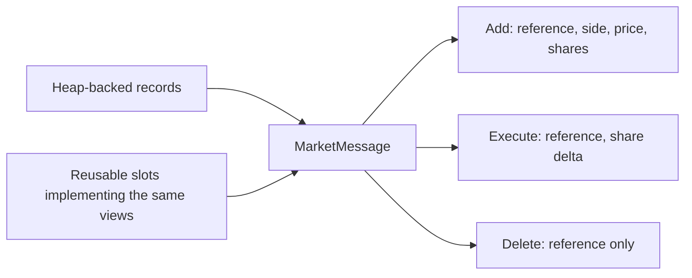

# `:feed-core`

Defines [`MarketMessage`](src/main/java/io/github/alchevrier/feed/core/MarketMessage.java),
the contract between a protocol decoder and a single-instrument order book.
Transport headers, feed sequence numbers, and instrument routing stay outside
this contract.

The sealed root fixes the event kinds, not how they're stored. The built-in
factories return immutable heap records; a producer can instead implement a
read-only event view over a reusable slot. Consumers copy any values they need
after the handoff. References are opaque 64-bit identifiers, prices use units of
1/10,000, and quantities use `long`.

Run `./gradlew :feed-core:test` from the repository root.
See [ADR-001](../docs/adr/ADR-001-reference-order-book.md) for the event contract.
