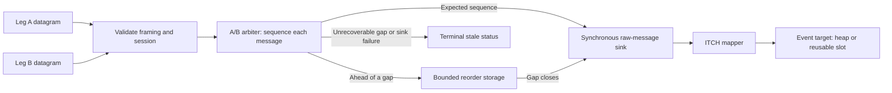

# `:nasdaq-feed`

Validates MoldUDP64 datagrams, merges two redundant legs, and maps ordered
ITCH add, execute, and delete payloads into `MarketMessage` events for one
configured stock locate. Live UDP ingress and threaded handoffs are not
implemented yet.

The arbiter validates the entire datagram before admitting any messages. It
keeps the first valid copy of each message sequence. Heartbeat and
end-of-session packets can reveal gaps but don't consume a sequence. If a gap
times out or a new pending message would exceed capacity, delivery stops and
the stream becomes stale.

`acceptAndForward` requires a synchronous sink that borrows in-order bytes
directly from the input buffer.
Out-of-order payloads are copied into heap-backed or preallocated reorder
storage, so the caller can reuse the datagram after the call returns. Packet
descriptor allocation is independently selectable. `acceptAndCopy` allocates
a list of owned copies for callers that need to retain messages.

The mapper reads the borrowed byte range in network byte order without
retaining it. Recognized non-book messages and order updates for other stock
locates consume sequence numbers without changing the tracked book. Malformed
payloads, unknown types, and unsupported mutations of the tracked book fail
the sink and mark the stream stale. Reusable events are valid only during
their consumer callback.

Run `./gradlew :nasdaq-feed:test` from the repository root. Tests use synthetic
datagrams and caller-supplied time, with no sockets or capture files. See
[ADR-002](../docs/adr/ADR-002-portable-udp-feed.md) for the wire format and
ownership rules.
