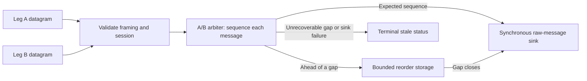

# `:nasdaq-feed`

Validates MoldUDP64 datagrams and merges two redundant legs into one ordered
stream of **raw ITCH payloads**. The current implementation takes datagram
buffers in memory. Live UDP ingress, threaded handoffs, and ITCH decoding are
not implemented yet.

The arbiter validates the entire datagram before admitting any messages. It
keeps the first valid copy of each message sequence. Heartbeat and
end-of-session packets can reveal gaps but don't consume a sequence. If a gap
times out or a new pending message would exceed capacity, delivery stops and
the stream becomes stale.

The synchronous sink borrows in-order bytes directly from the input buffer.
Out-of-order payloads are copied into heap-backed or preallocated reorder
storage, so the caller can reuse the datagram after `accept` returns. Packet
descriptor allocation is independently selectable. The list-returning API
makes owned copies for callers that need to retain messages.

Run `./gradlew :nasdaq-feed:test` from the repository root. Tests use synthetic
datagrams and caller-supplied time, with no sockets or capture files. See
[ADR-002](../docs/adr/ADR-002-portable-udp-feed.md) for the wire format and
ownership rules.
