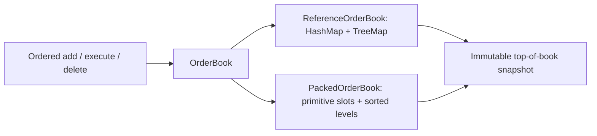

# `:order-book`

Reconstructs the displayed book for one instrument from already sequenced
[`MarketMessage`](../feed-core/README.md) events. Both implementations share the
same [`OrderBook`](src/main/java/io/github/alchevrier/feed/book/OrderBook.java)
contract. They apply the exchange's fills by order reference; they don't match
orders or maintain price-time priority.

The reference book favors simple mutations with standard collections. The packed
book preallocates order slots and keeps the best price at index zero on each
side. Its reference index points to stable order slots, so inserting or
removing a price level shifts only the price and quantity arrays. Quantity-only
updates don't shift levels. Capacity exhaustion rejects an add without
changing the book.

A single thread owns the book. `apply` reports whether the best price or
aggregate size changed; the caller decides when to publish a snapshot.
`topOfBook()` is the convenience immutable read and can allocate.
`readTopOfBook(buffer)` lets the writer reuse one scratch buffer; the
packed implementation fills it directly from the best levels.

Run `./gradlew :order-book:test` from the repository root to exercise the shared
Spock contract and packed-book capacity and slot reuse. See
[ADR-001](../docs/adr/ADR-001-reference-order-book.md) for the design tradeoffs.
